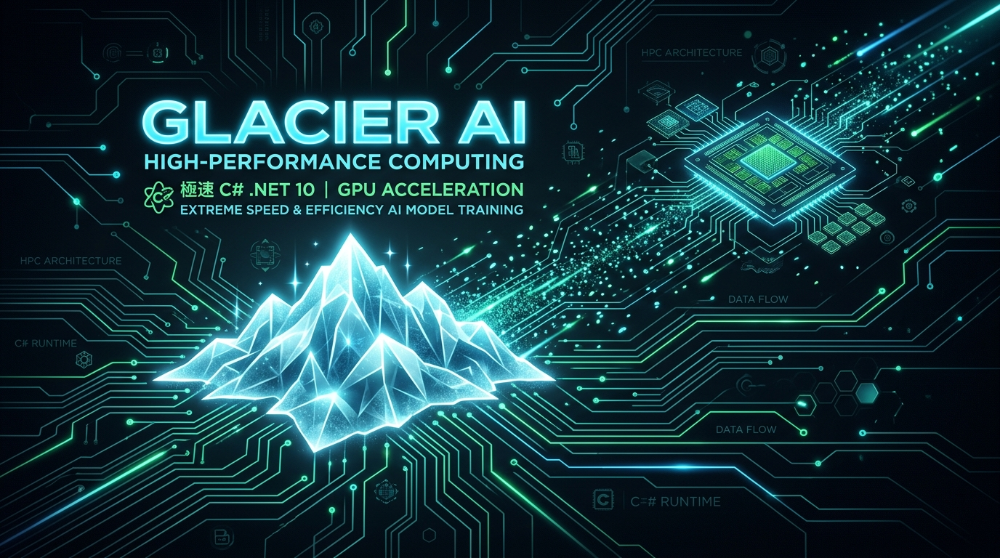

# Glacier.Rag

[](https://github.com/ian-cowley/Glacier.Rag/actions/workflows/dotnet.yml)
[](LICENSE)


`Glacier.Rag` is an in-process GraphRAG library for .NET 10. It stores dense semantic embeddings (`Glacier.Vector`), extracted entity graphs (`Glacier.Graph`), and local language model sessions (`Glacier.Inference`) inside one memory space—with no external vector database or graph service required.

---

## Install

```bash
dotnet add package Glacier.Rag
```

Or build from source:

```bash
git clone https://github.com/ian-cowley/Glacier.Rag.git
cd Glacier.Rag
dotnet test Glacier.Rag.slnx -c Release
```

---

## Quick Start

Index documents and retrieve hybrid vector + knowledge-graph context:

```csharp
using Glacier.Rag.Embeddings;
using Glacier.Rag.Engine;

using var rag = new GraphRagEngine(new FastHashEmbeddingModel(384));

rag.IndexDocument("SPEC-LEDGER", """
    The LedgerService manages all double-entry ledger transactions.
    LedgerService depends on SqlServerDatabase for durable storage.
    CustomerRecord streams from SqlServerDatabase with zero buffering.
    """);

HybridRetrievalResult result = rag.Retrieve(
    "How does CustomerRecord stream data?",
    new RagOptions { TopK = 3, MaxGraphHops = 2 });

foreach (var rel in result.GraphRelations)
{
    Console.WriteLine($"{rel.Source} --[{rel.Relation}]--> {rel.Target}");
}

string prompt = rag.BuildAugmentedPrompt("How does CustomerRecord stream data?", result);
```

To index and query asynchronously against a local or remote OpenAI-compatible `/v1/embeddings` endpoint (such as AMD XDNA 2 NPU sidecars):

```csharp
using var embedder = await OpenAiEmbeddingModel.CreateAutoAsync(
    baseUrl: "http://127.0.0.1:52625",
    modelId: "embeddinggemma");

using var rag = new GraphRagEngine(embedder);
await rag.IndexDocumentAsync("SPEC-AUTH", authSpecText);
var res = await rag.RetrieveAsync("How are tenant claims extracted?");
```

---

## What You Can Do

- **Unified Vector + Graph Indexing:** `GraphRagEngine.IndexDocument` / `IndexDocumentAsync` split text with sentence/paragraph awareness (`DocumentChunker`), store embeddings in an in-memory `HnswVectorIndex`, and record extracted entities and relationships (`EntityExtractor`) into a `GraphStore`.
- **Four Pluggable Embedding Backends:** Choose between sub-microsecond lexical hashing (`FastHashEmbeddingModel`), SIMD linear projection (`LinearProjectionEmbeddingModel`), local GGUF embeddings via `Glacier.Inference` (`GlacierInferenceEmbeddingModel`), or HTTP batch embeddings via `OpenAiEmbeddingModel`.
- **HippoRAG PPR Hybrid Reranking:** Combine dense HNSW cosine similarity, cached CSR knowledge-graph Personalized PageRank (`HybridGraphScorer.ScoreAndRerankHippoRag`), and Reciprocal Rank Fusion (RRF).
- **Prompt Sanitization & Streaming Synthesis:** Escape LLM control tokens automatically (`BuildAugmentedPrompt`) and stream grounded answers in-process with `GraphRagEngine.AskAsync(query, inferenceSession, ...)`.

---

## Platform & Compatibility

- **Runtime:** .NET 10 (`net10.0`), Native AOT compatible (`IsAotCompatible=true`).
- **SIMD Acceleration:** AVX-512F, AVX2/FMA, and `Vector128` intrinsics for L2 normalization and GEMV projections (`SimdEmbeddingMath`, `LinearProjectionEmbeddingModel`).
- **Cross-Platform:** Tested on Windows and Linux x64 in GitHub Actions CI.

---

## Documentation

- [User Manual](docs/manual.md) — Sync/async `GraphRagEngine`, `RagOptions`, chunking, entity extraction, all 4 embedding models, and `AskAsync`
- [Architecture](docs/architecture.md) — Dual HNSW + CSR graph layout, cached `InMemoryCsrGraph` snapshots, HippoRAG PPR scoring, and concurrency model
- [Changelog](CHANGELOG.md) — Release history from `v1.0.2` through `v1.4.3`

---

## License & Credits

Licensed under the [MIT License](LICENSE).

Developed by Ian Cowley, Antigravity (Google DeepMind) and Claude.
