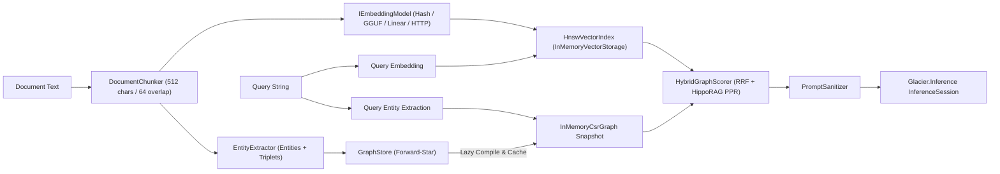

# Glacier.Rag Architecture

`Glacier.Rag` runs vector similarity, knowledge-graph traversal, and LLM inference inside one .NET process so retrieval never serializes vectors or prompts over local sockets unless an external HTTP embedding endpoint (`OpenAiEmbeddingModel`) is explicitly chosen.

---

## Hybrid Retrieval Pipeline

---

## Subsystems & Invariants

### 1. Dual Vector + Graph Storage

- **Vector store (`HnswVectorIndex` + `InMemoryVectorStorage`):** Indexed by unique `ChunkId` (`{docId}_{chunkIdx}`) so identical boilerplate blocks across separate documents never overwrite each other.
- **Knowledge graph (`GraphStore`):** Stores entity nodes, chunk-to-entity links, and typed predicates extracted by `EntityExtractor`.
- **Cached CSR snapshot (`InMemoryCsrGraph`):** On the first query (or after a new write invalidates `_csrSnapshot`), `InMemoryCsrGraph.CompileFromForwardStar(_graphStore)` compiles a contiguous read-only CSR graph under `_csrSync` double-checked locking. Subsequent concurrent queries reuse the cached snapshot without recompiling.

### 2. HippoRAG Personalized PageRank & RRF (`HybridGraphScorer`)

- `ScoreAndRerank` fuses vector similarity ranks and graph hop proximity across the union of HNSW candidates and graph-expanded chunk IDs.
- `ScoreAndRerankHippoRag` runs personalized PageRank over the `InMemoryCsrGraph` seeded by query entities so multi-hop connected chunks (even when lexical overlap with the query is weak) surface alongside top dense vector hits.

### 3. Concurrency & Safe Disposal

- `_rwLock` (`ReaderWriterLockSlim` with recursion support) lets unbounded concurrent `Retrieve` / `RetrieveAsync` readers execute while serializing `IndexDocument` mutations.
- Asynchronous HTTP calls in `IndexDocumentAsync` and `RetrieveAsync` (`OpenAiEmbeddingModel.GenerateEmbeddingsAsync` / `GenerateEmbeddingAsync`) execute **outside** the write/read lock so network I/O never starves local queries or writers.
- Lock-free sign-bit gating on `_activeOps` ensures `Dispose()` waits for in-flight operations to drain before freeing native/pooled vector and graph storage.

### 4. Defense-in-Depth Prompt Escaping (`PromptSanitizer`)

Before assembling chat prompts in `BuildAugmentedPrompt`, both retrieved document text and user queries pass through `PromptSanitizer.Sanitize`. A fast `SearchValues<char>` pre-scan avoids allocations on clean strings, while strings containing `<`, `[`, or fullwidth vertical bar `\uFF5C` invoke `BpeTokenizer.SanitizePrompt` plus targeted escaping for ChatML, LLaMA 3, DeepSeek, Gemma, Mistral, Inkling-2, and reasoning tags.
